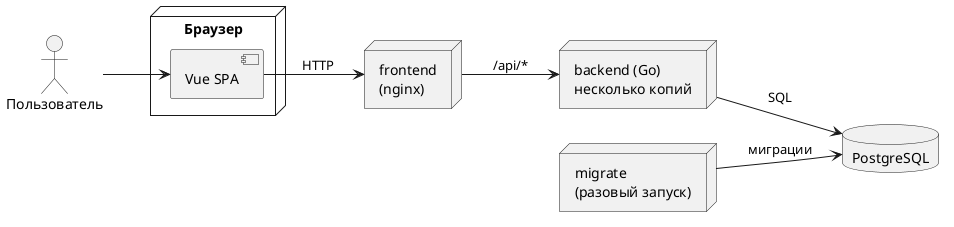
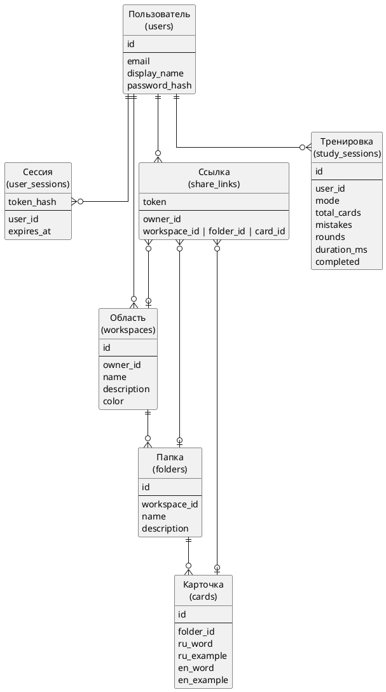
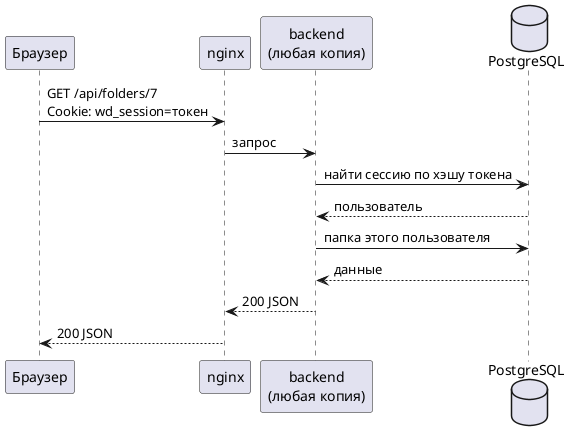

# Отчёт по домашнему заданию №1: приложение WordDeck

## 1. Доменная область

WordDeck — веб-приложение для изучения английских слов по карточкам.

Слова хранятся на трёх уровнях:

- область — большая тема, например «Английский B2» или «IT-лексика». Первая область создаётся сама при регистрации;
- папка внутри области — группа слов: «Еда», «Глаголы движения»;
- карточка внутри папки. С одной стороны русское слово с примером, с другой — английское с примером.

Что умеет приложение:

1. Просмотр карточек. Нажатие переворачивает карточку, долгое нажатие показывает пример.
2. Добавление карточек: по одной или импортом из CSV, TSV, TXT и JSON. Перед импортом видно, в каких строках ошибки. Папку можно выгрузить в CSV или JSON.
3. Режим «Учить». Карточки идут в случайном порядке. Свайп влево — «знаю», вправо — «не знаю», и тогда карточка вернётся позже. Тренировка заканчивается, когда все слова отмечены как известные. Последний ход можно отменить.
4. Режим «Диктант». Нужно написать перевод. Регистр и разница между «ё» и «е» не учитываются. Ошибки подсвечиваются, а слова с ошибками повторяются в следующем раунде, пока не будут написаны верно.
5. Режим «Сопоставление». Нужно соединить слова с переводами. Раунды по 4, 6 или 8 пар, есть таймер и счётчик ошибок.
6. Общий доступ по ссылке на область, папку или карточку. По ссылке можно смотреть и тренироваться без регистрации, а зарегистрированный пользователь может скопировать материал к себе. Ссылку можно отозвать.
7. Статистика: число тренировок, точность, сколько дней подряд были занятия, активность за последние две недели и история.
8. Аккаунт: регистрация, вход, выход (в том числе на всех устройствах), смена имени и пароля, удаление аккаунта.

## 2. Стек

- Backend — Go 1.25 на стандартной библиотеке `net/http`. Миграции через goose, пароли хэшируются argon2id.
- База данных — PostgreSQL 16.
- Frontend — Vue 3 и Vue Router, сборка Vite. Сторонние UI-библиотеки не используются.
- nginx 1.28 отдаёт собранный frontend и перенаправляет запросы `/api` на backend.
- Всё запускается в Docker через Docker Compose.
- Клиент и сервер общаются по REST, данные в JSON.
- Проверки: тесты на Go (часть из них работает с настоящим PostgreSQL через testcontainers), сквозной тест API на Python, браузерный тест на Playwright, линтеры для Go и JS.

Приложение лёгкое: образ backend весит около 25 МБ, процесс занимает 20–50 МБ памяти.

### Архитектура



Браузер общается только с nginx. Backend не хранит данных у себя, всё лежит в PostgreSQL, поэтому можно запустить несколько копий backend или перенести его на другой сервер, и frontend при этом менять не нужно.

Код backend разбит на слои: обработка HTTP-запросов, бизнес-логика и работа с базой. Каждый слой вызывает только следующий за ним.

Ошибки API возвращаются в виде кода, например `{"error": {"code": "too_long", "field": "name", "params": {"max": 100}}}`. Текст сообщения для пользователя собирает frontend. Ограничения вроде максимальной длины названия frontend получает от сервера, поэтому подсказки в формах и проверка на сервере всегда совпадают.

## 3. Основные сущности



Операции над сущностями:

- пользователь — регистрация, профиль, смена имени и пароля, удаление;
- сессия — создаётся при входе, удаляется при выходе, смене пароля и удалении аккаунта;
- область и папка — создание, просмотр, изменение, удаление; папку можно перенести в другую область;
- карточка — то же самое плюс поиск, импорт, экспорт, массовое удаление и перенос в другую папку;
- ссылка — создание, отзыв, просмотр без аккаунта, копирование себе;
- тренировка — сохранение результата, история, удаление, статистика.

Целостность данных проверяет сама база. При удалении области удаляются её папки, карточки и ссылки на них, при удалении пользователя — всё, что ему принадлежало. Длины полей ограничены прямо в таблицах. Ссылка всегда указывает ровно на один объект, и на один объект может быть не больше одной ссылки.

Права доступа проверяются в SQL-запросах: каждый запрос выбирает только данные текущего пользователя. На запрос к чужому объекту сервер отвечает 404, так же как на несуществующий.

### REST API

| Запросы | Назначение |
|---|---|
| `POST /api/auth/register`, `/login`, `/logout`, `/logout-all` | регистрация, вход и выход |
| `GET/PATCH/DELETE /api/me`, `PUT /api/me/password` | профиль |
| `/api/workspaces`, `/api/workspaces/{id}` | области |
| `/api/workspaces/{id}/folders`, `/api/folders/{id}` | папки |
| `/api/folders/{id}/cards`, `/api/cards/{id}` | карточки |
| `POST /api/folders/{id}/import`, `GET /api/folders/{id}/export` | импорт и экспорт |
| `/api/shares`, `/api/public/shares/{token}` | ссылки общего доступа |
| `/api/study-sessions`, `GET /api/stats` | тренировки и статистика |
| `GET /api/limits` | ограничения для форм |
| `GET /healthz`, `GET /readyz` | проверка состояния backend (доступны внутри Docker, через nginx не открываются) |

## 4. Соответствие «12 факторам»

### 4.1. Кодовая база

Весь код лежит в одном репозитории: backend, frontend, миграции и настройки Docker. Разные окружения отличаются только значениями переменных окружения, отдельных веток или файлов под каждое окружение нет.

### 4.2. Зависимости

Все зависимости объявлены явно и с точными версиями. У Go это `go.mod` и `go.sum`, при сборке проверяются контрольные суммы. У frontend это `package-lock.json`, пакеты ставятся через `npm ci`, который устанавливает ровно то, что записано в lock-файле. Версии Docker-образов (PostgreSQL, nginx, Node, Alpine) тоже зафиксированы. Backend собирается в статический бинарник и не зависит от системных библиотек.

### 4.3. Конфигурация

Все настройки берутся из переменных окружения: адрес базы, порт, время жизни сессии, таймауты, размер пула соединений, уровень логов. При запуске они проверяются, и если чего-то не хватает или значение некорректное, программа сразу завершается с понятной ошибкой.

Правила самого приложения, например минимальная длина пароля, остаются константами в коде, потому что они одинаковы везде.

Собранный frontend не знает адреса backend: он обращается к `/api` на том же сервере, а куда перенаправлять запросы, nginx узнаёт из переменной при запуске. Поэтому один и тот же образ frontend подходит для любого окружения.

Пароль от базы хранится в `.env`, который не попадает в репозиторий. В репозитории лежит только пример `.env.example`.

### 4.4. Сторонние службы

База данных подключается по адресу из `DATABASE_URL`. Чтобы перейти на облачную базу, достаточно поменять эту переменную. При запуске backend ждёт, пока база станет доступна, поэтому порядок запуска контейнеров не важен.

### 4.5. Сборка, релиз, выполнение

Эти этапы разделены:

- сборка — `docker compose build` создаёт образы, в которые записывается номер версии (его видно в `/healthz`);
- релиз — образ нужной версии плюс переменные окружения;
- выполнение — `docker compose up` запускает контейнеры.

В образе backend нет исходного кода, только бинарник, поэтому код во время работы поменять нельзя. Чтобы откатиться, достаточно запустить образ предыдущей версии.

### 4.6. Процессы

Backend не хранит состояние ни в памяти, ни на диске. Все данные, включая сессии, лежат в PostgreSQL. В cookie хранится случайный токен, а в базе — его хэш. Из-за этого любая копия backend может обработать любой запрос, а сессию можно отозвать сразу, например при смене пароля.



Настройки интерфейса, например выбранная сторона карточки, хранятся в браузере, а не на сервере.

### 4.7. Привязка портов

Backend сам является HTTP-сервером и слушает порт из переменной `PORT`, отдельный веб-сервер ему не нужен. Frontend в nginx тоже работает на своём порту.

### 4.8. Параллелизм

Чтобы выдержать больше нагрузки, достаточно запустить больше копий backend:

```bash
docker compose up -d --scale backend=3
```

Копии не конфликтуют, потому что backend не публикует порт наружу. nginx находит их через DNS Docker и распределяет запросы, в том числе на копии, добавленные после его запуска. Число соединений с базой у каждой копии ограничено, чтобы при росте числа копий не превысить лимит PostgreSQL.

### 4.9. Утилизируемость

Процесс можно быстро запустить и в любой момент остановить без потери данных. Backend запускается за доли секунды. При получении сигнала остановки он:

1. начинает отвечать 503 на `/readyz`, чтобы на него перестали отправлять запросы;
2. перестаёт принимать новые соединения;
3. ждёт, пока завершатся текущие запросы;
4. закрывает соединения с базой.

Действия из нескольких шагов (регистрация, импорт, копирование по ссылке, смена пароля, миграции) выполняются в транзакциях, поэтому внезапная остановка не оставит данные записанными наполовину. Ошибка в одном запросе не роняет весь процесс: сервер ответит 500 и продолжит работу.

### 4.10. Паритет разработки и работы приложения

Локально приложение запускается теми же образами и тем же `docker-compose.yml`, что и на сервере. Везде используются одни и те же PostgreSQL 16 и nginx 1.28, никакой подмены вроде SQLite при разработке нет. Тесты тоже работают с настоящим PostgreSQL той же версии.

### 4.11. Журналирование

Backend не пишет логи в файлы, а выводит их в stdout в формате JSON. На каждый запрос пишется одна строка: метод, путь, статус, время ответа, id запроса и пользователя. nginx присваивает каждому запросу id, поэтому записи nginx и backend легко сопоставить. Собирать логи — задача окружения, локально их можно смотреть через `docker compose logs`.

### 4.12. Задачи администрирования

Миграции базы запускаются командой того же бинарника: `server migrate`. В compose для этого есть отдельный сервис `migrate`, который запускается один раз, и backend стартует только после того, как миграции прошли успешно. Каждую миграцию можно откатить, а повторный запуск ничего не меняет.

### Ограничения

- На каждый запрос к API приходится один запрос к базе для проверки сессии. Это плата за возможность сразу отзывать сессии.
- Ограничение числа попыток входа сделано в nginx. Если запустить несколько копий frontend, у каждой будет свой счётчик.
- Локальный стенд работает по HTTP, поэтому флаг `Secure` у cookie там выключен. При работе по HTTPS его нужно включить.

## 5. Запуск

```bash
cp .env.example .env
docker compose up --build
```

Приложение откроется на http://localhost:8080.

Проверка API и запуск тестов:

```bash
python3 scripts/smoke_test.py http://localhost:8080
cd backend && go test ./...
```
