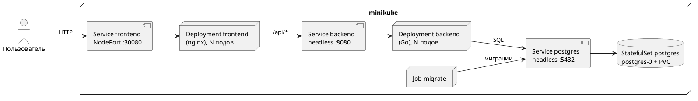

# Отчёт по домашнему заданию №2: WordDeck в Kubernetes(Отчет 1 я сохранил у себя в гит)

## 1. Окружение

- Docker 29.8.2
- minikube 1.39.0, драйвер `docker`, Kubernetes 1.37.0
- kubectl 1.37.1

Кластер запускается с рантаймом docker. По умолчанию minikube использует containerd, и тогда команда `minikube docker-env` не работает.

```bash
minikube start --driver=docker --container-runtime=docker --memory=3072 --cpus=4
```

## 2. Сборка образов

Приложение состоит из двух собственных образов. Dockerfile для них уже были написаны для docker compose и не менялись: всё, что отличается в Kubernetes, задаётся переменными окружения.

- `worddeck-backend` — бинарник на Go в образе alpine. Одна и та же программа запускает сервер (`serve`) и миграции (`migrate`).
- `worddeck-frontend` — собранное Vue-приложение в nginx. Конфиг nginx собирается из шаблона при старте контейнера.

Образы собираются сразу в docker-демоне внутри minikube, поэтому загружать их в кластер отдельно не нужно:

```bash
eval $(minikube docker-env)
docker build -t worddeck-backend:1.0.0 --build-arg VERSION=1.0.0 backend
docker build -t worddeck-frontend:1.0.0 frontend
```

Если образ собран обычным docker на хосте, его можно загрузить командой `minikube image load worddeck-backend:1.0.0`.

В манифестах стоит `imagePullPolicy: Never`: образы берутся только из minikube, а если их там нет, под сразу показывает ошибку `ErrImageNeverPull` и не пытается скачать образ из Docker Hub.

## 3. Использованные абстракции Kubernetes

Манифесты лежат в каталоге `k8s/`:

| Файл | Объекты |
|---|---|
| `kustomization.yaml` | список манифестов и namespace для всех объектов |
| `namespace.yaml` | Namespace `worddeck` |
| `config.yaml` | Секреты `postgres`, ConfigMap `postgres`, `backend`, `frontend` |
| `postgres.yaml` | StatefulSet и headless Service `postgres` |
| `migrate.yaml` | Job `migrate` |
| `backend.yaml` | Deployment и headless Service `backend` |
| `frontend.yaml` | Deployment и Service `frontend` типа NodePort |

**Namespace.** Все объекты приложения лежат в отдельном пространстве имён `worddeck`. Их удобно смотреть одной командой и удалять вместе, и они не смешиваются с системными подами minikube.

**Kustomization.** Нужна, чтобы применить весь каталог одной командой `kubectl apply -k k8s` и не прописывать namespace в каждом файле. Kustomize встроен в kubectl, отдельно ставить ничего не нужно. Он же создаёт Namespace раньше остальных объектов.

**ConfigMap и Secret.** Настройки, которые раньше лежали в `.env`, разделены на три ConfigMap(угарный факт, я ща на работе перевожу сервисы с ConfigMap, на внутрение БД, тк у нас еще лежали некоторые пользовательские настройки вне сервиса): для postgres, backend и frontend. Каждый контейнер получает только свои переменные через `envFrom`. Пароль базы хранится в Secret. Строку подключения `DATABASE_URL` Kubernetes собирает сам из переменных `POSTGRES_USER`, `POSTGRES_PASSWORD` и `POSTGRES_DB` через подстановку `$(ИМЯ)`, поэтому пароль указан только в одном месте.

**StatefulSet и PersistentVolumeClaim.** PostgreSQL запущен как StatefulSet с одной репликой. В отличие от Deployment, у пода постоянное имя `postgres-0`, а диск создаётся из `volumeClaimTemplates` и привязан именно к этому поду. Если под пересоздать, он подключит тот же PVC `data-postgres-0`, и данные сохранятся. Диск выдаёт стандартный provisioner minikube (StorageClass `standard`).

**Job.** Миграции выполняются один раз, поэтому это Job, а не Deployment. Под с миграциями ждёт, пока поднимется база, применяет миграции и завершается со статусом `Completed`. Если что-то пошло не так, Job перезапускает его до 5 раз. goose берёт блокировку в базе, поэтому повторный запуск Job ничего не ломает. Через 10 минут после завершения Job удаляется автоматически (`ttlSecondsAfterFinished`), а при следующем `kubectl apply` создаётся заново и проверяет, что новых миграций нет.

**Deployment, ReplicaSet, Pod.** Backend и frontend не хранят состояние, поэтому запущены как Deployment по 2 реплики. Deployment создаёт ReplicaSet, а тот поддерживает нужное число подов. При обновлении образа backend поды заменяются по одному: сначала запускается новый, и только когда он готов, удаляется старый (`maxSurge: 1`, `maxUnavailable: 0`).

**Probes.** У всех подов есть проверки:

- readiness — готов ли под принимать запросы. Пока проверка не проходит, под не получает трафик. Backend на `/readyz` проверяет соединение с базой и при остановке сразу начинает отвечать 503;
- liveness — жив ли процесс. Если проверка не проходит несколько раз подряд, Kubernetes перезапускает контейнер. Backend проверяется через `/healthz`, frontend через `/nginx-health`, PostgreSQL через `pg_isready`.

`terminationGracePeriodSeconds: 20` у backend больше, чем `SHUTDOWN_TIMEOUT` (15 с), поэтому backend успевает завершить текущие запросы до принудительной остановки.

**initContainer.** Перед nginx в поде frontend запускается контейнер `wait-backend`, который ждёт, пока имя `backend` начнёт резолвиться, то есть пока не появится хотя бы один готовый под backend. Без этого nginx стартовал раньше backend, и первые запросы к API получали 502, пока nginx не перерезолвит имя.

**Service.** Используются два типа:

- headless (`clusterIP: None`) для `postgres` и `backend`. У такого сервиса нет общего IP, а DNS-имя сразу возвращает IP всех готовых подов;
- NodePort для `frontend`. Порт 30080 открыт на узле minikube, через него приложение открывается в браузере. У сервиса стоит `externalTrafficPolicy: Local`, поэтому nginx видит настоящий IP клиента, а не внутренний адрес узла. Это нужно для лимита попыток входа: он считается по IP, и без этой настройки все пользователи делили бы один общий лимит.

**Requests и limits.** У каждого контейнера указаны запрошенные ресурсы и предел памяти. Кластеру выделено 3 ГБ, и всё приложение даже после масштабирования помещается в них с запасом.

## 4. Как сервисы взаимодействуют



1. Браузер открывает `http://<minikube ip>:30080`. Service `frontend` направляет запрос на один из подов frontend.
2. nginx сам отдаёт страницы и статику, а запросы `/api/*` передаёт в backend по имени `backend.worddeck.svc.cluster.local:8080`.
3. Backend подключается к базе по имени `postgres:5432`. Этот адрес указан в `DATABASE_URL`.
4. Job `migrate` подключается к базе по тому же имени и до начала работы создаёт таблицы.

Сервисы находят друг друга по DNS-именам Service, а не по IP. IP подов меняются при каждом перезапуске, а имена остаются прежними.

Порядок запуска задан не явно, его обеспечивают проверки и повторные попытки. Backend и `migrate` при старте повторяют подключение к базе, пока она не ответит (до 60 секунд, `DB_CONNECT_TIMEOUT`). Backend не получает запросов, пока не пройдёт readiness-проверку. Frontend не запускается, пока нет готового backend.

### Почему backend — headless-сервис

Сначала backend был обычным Service с общим ClusterIP. После `kubectl scale` новые поды не получали запросов. nginx держит открытые соединения к backend (`keepalive`), а kube-proxy выбирает под один раз на соединение, поэтому все запросы продолжали идти на старые поды.

У headless-сервиса DNS возвращает IP каждого готового пода. nginx заново запрашивает имя каждые 10 секунд (`resolver ... valid=10s`, `server ... resolve`) и распределяет запросы между всеми подами сам. Так же это работало в docker compose: там DNS Docker тоже возвращал IP всех копий. В Kubernetes адрес DNS-сервера другой, поэтому в ConfigMap `frontend` указано `NGINX_RESOLVER: kube-dns.kube-system.svc.cluster.local`.

Проверка: после масштабирования backend с 2 до 4 реплик запросы smoke-теста дошли до всех четырёх подов. Новые поды начинают получать трафик в течение 10 секунд после того, как стали готовы. Под, который не готов или останавливается, исчезает из DNS и перестаёт получать запросы.

## 5. Запуск и масштабирование

```bash
kubectl apply -k k8s
kubectl -n worddeck get pods
minikube service frontend -n worddeck --url
```

Масштабирование:

```bash
kubectl -n worddeck scale deployment backend --replicas=4
kubectl -n worddeck scale deployment frontend --replicas=3
kubectl -n worddeck get pods -o wide
```

PostgreSQL не масштабируется: для нескольких реплик базы нужна репликация, а просто увеличить `replicas` у StatefulSet нельзя.

Удаление всего приложения вместе с данными:

```bash
kubectl delete -k k8s
```

## 6. Проверка

На развёрнутом в minikube приложении проходят те же проверки, что и на docker compose:

```bash
python3 scripts/smoke_test.py http://$(minikube ip):30080
```

Smoke-тест выполняет 90 проверок API. Браузерный сценарий из `scripts/e2e` проходит регистрацию, все страницы, три режима обучения, импорт и удаление аккаунта.

## Ограничения

- Пароль базы в Secret только закодирован в base64, а не зашифрован. Для учебного стенда это допустимо, в настоящем кластере пароль стоит хранить во внешнем хранилище секретов и не держать в репозитории.
- Лимит попыток входа считается в каждом поде frontend отдельно, поэтому с N репликами frontend реальный лимит в N раз выше.
- PostgreSQL работает в одном экземпляре. Если под `postgres-0` перезапускается, приложение недоступно, пока база не поднимется, но данные на PVC сохраняются.
- `imagePullPolicy: Never` подходит только для minikube. Для настоящего кластера образы нужно публиковать в registry.
